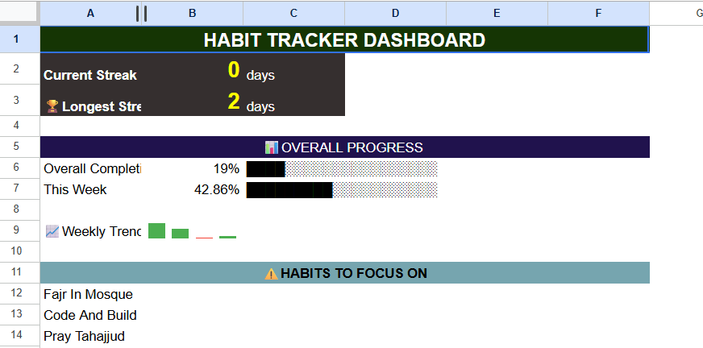

# Habit Tracker: Python & Google Sheets Automation

A personal habit tracking system that automatically logs daily habits, tracks completion rates, calculates streaks, and displays progress through a live Google Sheets dashboard.

Built with Python and the Google Sheets API. Runs automatically at login via Windows Task Scheduler.



## Features
- Auto-logs daily habits from a master config sheet
- Marks habits complete interactively from the terminal, including past dates
- Calculates current and longest streaks at a 70% daily threshold
- Auto-generates weekly performance summaries
- Live dashboard with progress bars, weekly trend chart, and streak display

## Tech Used
Python, Google Sheets API, gspread, google-auth, Windows Task Scheduler

## Setup

1. Create a Google Cloud project and enable the **Google Sheets API** and **Google Drive API**.
2. Create a service account and download its JSON key. Save it as `credentials.json` in the project root. This file is listed in `.gitignore` and must never be committed.
3. Create a Google Sheet named `Habit Tracker` with these tabs: `Daily Log`, `Habits Config`, `Weekly Summary`, `Global Tracker`, `Dashboard`.
4. Share the sheet with the service account's email address (Editor access).
5. In `Daily Log`, add the headers `Date`, `Day of Week`, `Week Number`, `Habit Name`, `Category`, `Completed`, `Notes`, and apply checkbox formatting to column F.
6. In `Habits Config`, add the headers `Habit Name`, `Category`, `Active`, then list your habits.
7. Install dependencies:

```
pip install -r requirements.txt
```

## Daily Usage

| Script | When to run | What it does |
|---|---|---|
| `daily_logger.py` | Automatic at login | Logs today's habits to the Daily Log |
| `habit_marker.py` | Evening | Marks completed habits, for today or a past date |
| `streak_calculator.py` | When you want fresh numbers | Writes current and longest streak to Global Tracker |
| `weekly_updater.py` | Weekly | Rebuilds the Weekly Summary from the Daily Log |

## Limitations

- Requires an internet connection, because every script calls the Google Sheets API.
- Task Scheduler setup is Windows-specific.